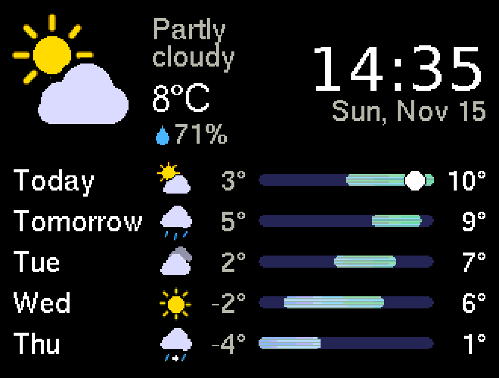
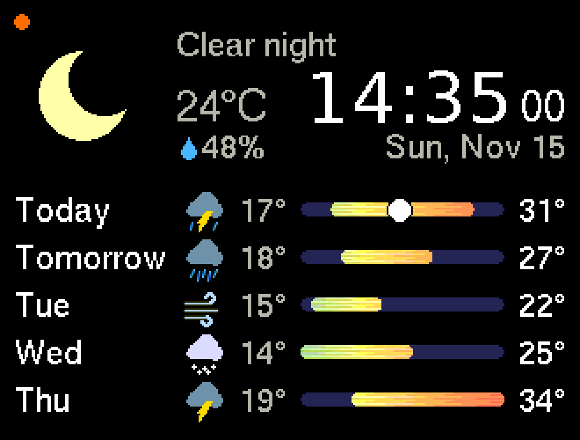
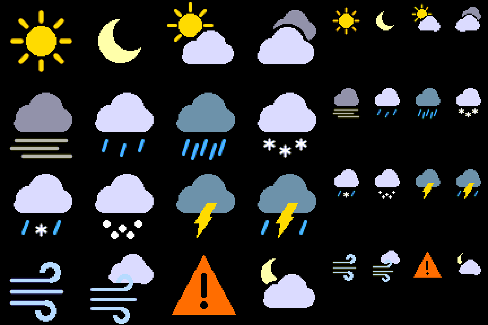
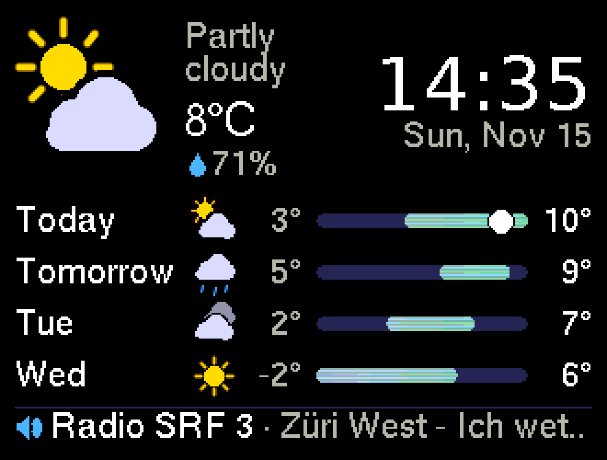

# ESP32 Weather Clock (composite video)

Turns an old alarm clock with a built-in 5" TV into a weather clock. An ESP32
generates a PAL (or NTSC) composite video signal with its internal DAC and
shows the time, current conditions and the forecast from **Home Assistant**.
The layout follows the
[clock-weather-card](https://github.com/pkissling/clock-weather-card) for Lovelace.



| Night, outdated data | Icons |
|---|---|
|  |  |

*(Images are rendered on the PC by [tools/preview](tools/preview) from the same
drawing code, using the 8-bit frame buffer format the ESP32 uses.)*

## Features
- Big clock with date, current condition icon/text, temperature and humidity
- Daily (or hourly) forecast rows with icon, min/max and a temperature-colored
  range bar; today's row shows a marker at the current temperature
- Day/night icons via `sun.sun`
- Weather icons drawn with vector primitives, so no bitmaps
- Animated large icon: turning sun rays, drifting clouds, falling rain/snow/hail, flashing lightning
  (`ICON_ANIMATION`, `ICON_ANIM_FPS` in `include/config.h`)
- Built-in settings page at http://weatherclock.local/ that is always available: WiFi, Home Assistant and
  timezone can be changed without rebooting. If the WiFi can't be joined, the clock opens its own access point
  with a captive portal
- Firmware updates over the network (web page upload or PlatformIO OTA)
- Web radio through a PCM5102 I2S DAC (or, at lower quality, the second internal DAC or a PWM pin): 8 station presets, volume, "now playing" on the TV,
  and an HTTP API so Home Assistant can use it as a radio alarm
- Backup alarm sound from flash (your own MP3) when the radio stream can't be played
- Flicker-free updates: each screen section is drawn off-screen first and then copied into the frame buffer
- An orange dot appears in the top-left corner when the data is older than 30 min. Errors are shown on screen

## Hardware
- Any ESP32 dev board with the original ESP32 chip (DAC on GPIO25/26). ESP32-S2/S3/C3 have no
  compatible DAC.
- Composite video: **GPIO25 → video signal**, **GND → video ground**. The
  [ESP32_Trainboard](https://github.com/kilrah/ESP32_Trainboard) project drives a TV directly this way.

- Audio (optional): PCM5102 I2S DAC module on the ESP32's second I2S port (the first one
  generates the video):

  | PCM5102 | ESP32 |
  |---|---|
  | VIN | 5V (or 3V3) |
  | GND | GND |
  | BCK | GPIO4 |
  | LCK (LRCK) | GPIO15 |
  | DIN | GPIO2 |
  | SCK | GND, the module's SCK solder bridge, or a GPIO driven low (`I2S_SCK_LOW_PIN`, default GPIO16). **Never leave it floating**: the DAC then drops out intermittently |
  | FMT, FLT, DEMP | GND (solder jumpers H4L, H1L, H2L on "L") |
  | XSMT | 3V3 (jumper H3L on "H"), otherwise the DAC stays muted |

  The line output (~2 V RMS) goes to an amplifier, e.g. the TV's own audio amplifier
  (at its volume pot). Pins can be changed with `I2S_*_PIN` in `config.h`.

- Audio without the PCM5102 (lower quality, mono), selected with `AUDIO_OUTPUT` in `config.h`
  or by building one of these environments:

  | Environment | `AUDIO_OUTPUT` | Output |
  |---|---|---|
  | `esp32dev_pal` | 0 | PCM5102 on I2S1 (above) |
  | `esp32dev_pal-dac` | 1 | GPIO26, the ESP32's second internal DAC. 8 bits with noise shaping. The video's I2S stream drives both DACs, so the audio goes through I2S0's "constant value" channel and is updated by a timer interrupt at the sample rate. If there is no sound or the picture is lost, try `-D AUDIO_DAC_CHAN_MOD=4` |
  | `esp32dev_pal-pwm` | 2 | GPIO26 (`AUDIO_PWM_PIN`), LEDC PWM at 312.5 kHz, 8 bits + 4 bits of hardware dithering |

  Both use the same wiring: GPIO26 → 1 kΩ → 10 nF to GND → 4.7 kΩ → 2.2 nF to GND
  (two RC low-pass stages at ~15 kHz) → 1 µF → amplifier input. The output swings 0–3.3 V
  around a 1.65 V idle level. Both options cost one interrupt per sample (44,100/s) on core 0.
  They use 4 KB of RAM for the sample buffer and save the ~5 KB of I2S DMA buffers.

### Connecting to the alarm clock TV
The TV in these clocks expects an RF/antenna signal. If the set has an AV/video
input, use that. If it doesn't, you have to inject the composite signal after the tuner, at the point
where the demodulated video enters the video/chroma processor. On many single-chip
TV designs this is the "CVBS in" / "AV in" pin of the main IC. The IF/tuner section often has its own
"video out" that you can disconnect. Look up the datasheet of the main chip. A 75 Ω
termination to ground at the injection point and a ~100 nF coupling capacitor
are usually a good idea if the input is AC-coupled. If the picture is too dark or too
bright, adjust `CVBS_OUTPUT_LEVEL`.

## Home Assistant setup
1. Use Home Assistant 2024.8 or newer (the forecast is read via the
   `weather.get_forecasts` service with `?return_response`).
2. Create a **long-lived access token**: Profile → Security → Long-lived access tokens.
3. Find your weather entity ID, e.g. `weather.forecast_home` (Met.no default).

## Build & flash
1. Copy `secrets.example.ini` to `secrets.ini` (git-ignored) and fill in your WiFi, an OTA
   password and optionally the HA token. These are only the defaults: everything except the
   OTA password can be changed on the settings page later.
2. Optionally edit [include/config.h](include/config.h) (HA URL, 12/24h, rows, …).
   Every option can also be set as a build flag in `platformio.ini`, e.g. `-D CLOCK_24H=0`.
3. Upload over USB: `pio run -t upload`. Later updates can go over WiFi:
   `pio run -e esp32dev_pal-ota -t upload`, or upload `.pio/build/esp32dev_pal/firmware.bin`
   on the page's *Firmware update* link (login `admin` / OTA password).
   The flash layout is in `partitions.csv` (two 1.44 MB firmware slots + 1 MB file system). A
   clock flashed before that file existed needs one more upload over USB; settings are kept.
4. Optional: [backup alarm sound](#backup-alarm-sound), `pio run -t uploadfs`.

## Settings page
Once the clock is on your WiFi, open **http://weatherclock.local/** (the IP address works too. It is
shown on the TV when there is no weather data). The page has these settings:
- Home Assistant URL, e.g. `http://192.168.1.10:8123` (http on the LAN is recommended. https
  works but the certificate isn't checked and it needs ~40 KB more RAM)
- Long-lived access token (write-only: leave the field empty to keep the stored one)
- Weather entity
- POSIX timezone (default is Central Europe: `CET-1CEST,M3.5.0,M10.5.0/3`,
  [list of zones](https://github.com/nayarsystems/posix_tz_db/blob/master/zones.csv))
- WiFi network and password (the password is write-only too)

Changes apply immediately: the weather is reloaded, and a changed WiFi network is joined right
away. The page also shows the WiFi signal, the last weather update and the last error.
Settings are stored in flash and survive firmware updates. *Reset to defaults* returns to
`config.h` / `secrets.ini`.

**If the WiFi can't be joined** (wrong password, new router, …) for 20 s, the clock opens its
own access point **weatherclock** and the TV shows how to connect. The password is the OTA
password if it has 8 or more characters, otherwise the network is open. Any web address opened
there leads to the settings page. While nobody is connected to it, the clock retries the saved
network every 2 minutes and closes the access point once it succeeds.

## Web radio
The radio section on the settings page has buttons for the stations, Stop, a volume slider
and the current title. Stations are edited on *Edit stations* (8 slots). That page also has an *At startup* option that starts a chosen station automatically after boot (once WiFi is up and the first weather update is done, or as soon as joining the WiFi has failed), and a *Volume fade-in* of up to 60 s for it: the sound, radio or backup alarm, rises from silence to the set volume. While the radio
plays, the TV shows the station and title at the bottom, with one forecast row fewer. A title that
doesn't fit scrolls, pausing for 2 s at the start of each pass.



Limits:
- **http:// MP3 streams only.** https needs ~40 KB more RAM than is left next to the video
  frame buffer, and AAC isn't decoded. Most stations still offer a plain http MP3 stream. Look one up on
  [radio-browser.info](https://www.radio-browser.info) (codec MP3, URL starting with `http://`).
  A stream that redirects to https won't play.
- **RAM is at its limit on an ESP32 without PSRAM** (measured): the frame buffer takes 73 KB,
  WiFi/lwIP/mDNS ~68 KB, and the radio permanently reserves 41 KB at boot (MP3 decoder, stream buffer and I2S buffers,
  so they can't fragment). That leaves ~30 KB free at idle and 3-15 KB while streaming. It works,
  but there is no safety margin. Use **http** for Home Assistant, because https needs ~40 KB more. For
  headroom (and https), use an ESP32 board with PSRAM (WROVER): the frame buffer can then
  move to PSRAM (`cfg.use_psram` in `include/crt.h`). The settings page shows free memory
  (byte-addressable RAM only) and the lowest value since boot. `DEBUG_HEAP_LOG_S` in `config.h`
  logs memory and task stack headroom to the serial port.
- Lost streams are reconnected automatically (3 s, 10 s, 30 s, then every minute).
- Loading the settings page while the radio plays can still cause a short dropout: serving the page
  holds the decoder up for 30-60 ms, and the I2S buffer covers 46 ms (`AUDIO_I2S_DMA_BUFFERS`, 0.5 KB
  of RAM per 2.9 ms). With `DEBUG_HEAP_LOG_S` the serial log shows the longest gap, the decoder's
  load and how often the stream buffer ran empty.

### Backup alarm sound
If the radio should play but there is no stream for 30 s (`RADIO_BACKUP_AFTER_S`: internet or
station down, stream lost and not coming back), the clock plays an MP3 file from its own flash
in a loop, so a wake-up doesn't fail silently. Each time the sound has played through, the stream
is tried again if a retry is due; the sound ends when the stream works or the radio is stopped.
This includes the station started by *At startup*: when the clock is powered by the TV's own
alarm, switching on is the wake-up. The 30 s then count from power-up, and it works without any
network: if the WiFi can't be joined (20 s), the sound starts about 30 s after power-up.

The sound is not part of this project. Put your own file at `data/alarm.mp3` (git-ignored, up to
~900 KB, without a big ID3 tag / cover art) and upload it over USB with `pio run -t uploadfs`.
The settings page shows whether it was found.

A wake-up triggered from Home Assistant (below) still needs the WiFi at alarm time for the play
command to arrive; only the power-up autoplay works without any network.

### Radio alarm from Home Assistant
The clock has a small HTTP API (no login, so keep it on your LAN). Station numbers are 1-8 as on *Edit stations*:

| Request | Effect |
|---|---|
| `POST /api/radio/play?station=2` | Play station 2 (without `station`: the last one). Optional `&fade=30`: fade the volume in over 30 s (max 60) |
| `POST /api/radio/play?url=http://...&name=Foo` | Play any http MP3 stream |
| `POST /api/radio/stop` | Stop |
| `POST /api/radio/volume?value=40` or `?change=-5` | Set or change the volume (0-100) |
| `GET /api/radio` | Status as JSON: `state` (`stopped`, `connecting`, `playing`, `retrying`, `backup`), `station`, `name`, `title`, `volume`, `error`, `backup_sound` (file present), `underruns` (audible gaps since boot) |

```yaml
# configuration.yaml (use the clock's IP if Home Assistant can't resolve .local names)
rest_command:
  clock_radio_play:
    url: "http://weatherclock.local/api/radio/play?station={{ station | default(1) }}"
    method: post
  clock_radio_stop:
    url: "http://weatherclock.local/api/radio/stop"
    method: post
  clock_radio_volume:
    url: "http://weatherclock.local/api/radio/volume?value={{ volume }}"
    method: post

rest:
  - resource: "http://weatherclock.local/api/radio"
    scan_interval: 15
    sensor:
      - name: "Clock radio"
        value_template: "{{ value_json.state }}"
        json_attributes: [station, name, title, volume, error]
```

A wake-up automation can call `rest_command.clock_radio_volume` with a low volume, then
`rest_command.clock_radio_play`, and raise the volume over a few minutes.

## Adjusting the picture
Old TVs overscan a lot. All settings are in [include/config.h](include/config.h):
- `CVBS_PANEL_WIDTH/HEIGHT`, `CVBS_OFFSET_X/Y`: drawn area and where it sits in the picture. Only this area
  uses RAM (1 byte per pixel); the layout adapts to its size
- `SCREEN_MARGIN`: extra black margin inside the drawn area (0: a smaller panel does the same without the RAM)
- `CVBS_PAL`: 1 for PAL, 0 for NTSC
- `CVBS_OUTPUT_LEVEL` / `CVBS_CHROMA_LEVEL`: brightness and color saturation
- `CVBS_GRAYSCALE`: 1 for black & white TVs. The picture carries no color information (no dot patterns
  from the color carrier) and has 256 gray levels. Icons and temperature bars switch to a palette
  designed for brightness (bars: darker = colder). Same memory use as 8-bit color.
- `CVBS_COLOR_DEPTH`: 8 (RGB332, default) or 16 (RGB565). 16-bit needs about 147 KB for the frame buffer, which is
  very tight next to WiFi on an ESP32 without PSRAM.

## Project layout
| File | Purpose |
|---|---|
| `src/main.cpp` | Setup, screen state, update loop |
| `src/webui.cpp` | WiFi join / fallback access point, settings page, firmware update (own task) |
| `src/settings.cpp` | Runtime settings in NVS, validation |
| `src/radio.cpp` | Web radio: audio task, MP3 decoding (ESP8266Audio), I2S1 output, stations |
| `src/ha_client.cpp` | Home Assistant REST calls (state, forecast, sun) |
| `src/ui.cpp` | Screen layout and rendering |
| `src/icons.cpp` | Procedural weather icons |
| `src/weather.cpp` | Data model, ISO-8601 parsing |
| `include/crt.h` | LovyanGFX composite video panel config |
| `include/config.h` | All user options |
| `tools/preview` | Renders the UI to PNG on a PC (no ESP32 needed) |

## UI preview on the PC
`ui.cpp`, `icons.cpp` and `weather.cpp` don't depend on Arduino, so they can be
compiled natively against LovyanGFX. With a g++ toolchain (e.g. MinGW) and Python
installed, and after one `pio run` so the library is downloaded:

```sh
sh tools/preview/build.sh                  # images in tools/preview/out
sh tools/preview/build.sh -DCLOCK_24H=0    # any config.h option can be overridden
```
